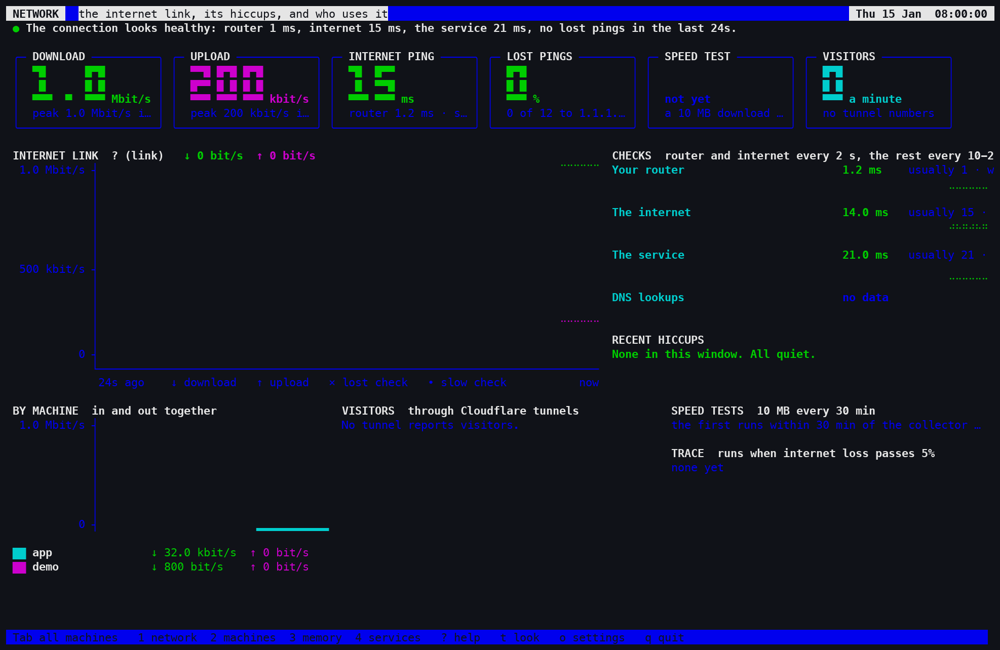
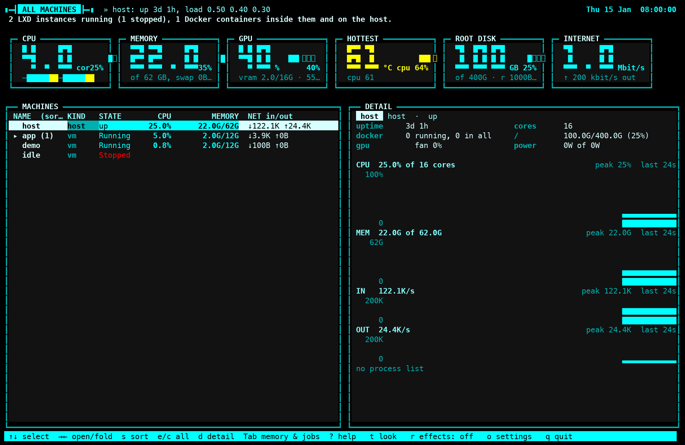

# lxtop

**A live terminal dashboard for a Linux server that runs LXD.** One screen shows the host, every
LXD virtual machine and container, the Docker containers inside them, the internet link and where
its hiccups are, memory pressure and who holds the memory, and which timers and services failed.
It runs in any terminal or straight on the server's own console, and comes with two dozen looks.





<sub>Both pictures are drawn by lxtop's own code from the test suite's sample snapshot, rendered
with the look's colours.</sub>

## What it replaces

On an LXD host you usually piece the picture together from several tools:

- **`lxc list`** for the instances, then **`lxc exec <vm> -- docker stats`** inside each one;
- **htop / btop** for the host itself, which can't see inside the VMs;
- **ping, mtr and a speed test** to work out whether a slow moment was your router, your provider
  or the far end;
- **`systemctl --failed`** and **`journalctl`** for what broke overnight.

lxtop collects all of it once every two seconds and draws it on one screen. It is read-only: it
never starts, stops or changes anything.

## Features

- **Network page (home).** One sentence that says whether the connection is healthy and, if not,
  where the trouble is: inside the house (router pings), at the provider (internet pings) or at one
  service. Download and upload chart with lost pings marked, ping and DNS timings, recent hiccups
  grouped into events, traffic per machine, visitors through Cloudflare tunnels, speed tests, and an
  automatic trace when loss passes 5%.
- **All machines page.** The host, every LXD instance and the Docker containers inside each, as a
  tree you can fold and sort, with CPU, memory and network charts and a detail pane per row.
  Containers running under gVisor show their own processes and traffic.
- **Memory & jobs page.** Room left for a new job, memory pressure, what each VM really costs the
  host (qemu's resident memory, not just what the guest reports), the user's biggest jobs, GPU
  memory per process, and out-of-memory kills from the last week.
- **Timers & services page.** The user's timers with their last result and next run, running
  services, and failed units with their last log lines.
- **Two dozen looks** (`t` to switch, or let them cycle): matrix rain, synthwave, sonar, an
  aquarium, a brick-breaker and more, each held to contrast rules so the data stays readable.
  `default` uses the terminal's own colours.
- **Built for the console too.** On a Linux virtual console it loads a font with the block
  characters graphs need and puts the console's own font back when it quits.
- **No dependencies.** Python standard library only. The probe that runs inside each instance is a
  single self-contained script, shipped over `lxc exec`.

## How it works

```
lxtop collect (root)                              lxtop view (any user)
  host: /proc, /sys, cgroups, nvidia-smi             reads the snapshot every interval
  LXD:  its REST API over the unix socket    ──▶     /run/lxtop/state.json   ──▶   draws a page
  each instance: probe.py via `lxc exec`
  pings, DNS, HTTPS timings, speed tests
```

The collector needs root (LXD's socket and other users' cgroups are root-only) and writes one JSON
snapshot. The viewer only reads that file, so anyone logged in can watch without privileges.

## Quick start

**You need:** a Linux host with the LXD snap and Python 3.12 or newer. Docker inside the instances
and `nvidia-smi` are optional: their sections just say so when they're missing.

```sh
git clone https://github.com/avoliva/lxtop.git && cd lxtop
uv sync

# Terminal 1: collect (as root). --user picks whose timers and jobs to show.
sudo .venv/bin/lxtop collect --user "$USER"

# Terminal 2: watch
.venv/bin/lxtop view
```

Keys: `Tab` or `1`-`4` change page, `t` / `T` change the look, `r` sets the effects, `o` opens the
settings (saved to `~/.config/lxtop/settings.json`), `?` shows every key, `q` quits.

To keep the collector running, a systemd unit is enough:

```ini
# /etc/systemd/system/lxtop-collect.service
[Unit]
Description=lxtop collector
After=snap.lxd.daemon.service

[Service]
ExecStart=/opt/lxtop/.venv/bin/lxtop collect --user admin
Restart=always

[Install]
WantedBy=multi-user.target
```

Useful options: `lxtop view --theme matrix`, `lxtop view --list-themes`, `lxtop view --cycle 0`
(keep one look), `lxtop collect --no-instances` (host only), `lxtop collect --no-checks` (no DNS,
HTTPS or speed tests).

## Development

```sh
make check    # ruff (lint and format), mypy --strict, pytest
```

About 1,500 tests. The viewer is tested against a fake window, and every page is drawn in every
look; saved text snapshots of key pages catch accidental drawing changes
(`UPDATE_GOLDEN=1 uv run pytest` rewrites them after a deliberate one). The collector is tested
with a fake sampler, fake LXD and fake probes, so no test needs root, LXD or a network.

Layout: `src/lxtop/core/` is pure logic (snapshot format, models, charts, wording),
`collector/` reads the machine, `looks/` holds one module per look, and `viewer/` is the curses
app with one module per page in `viewer/pages/`.

## License

[MIT](LICENSE)
